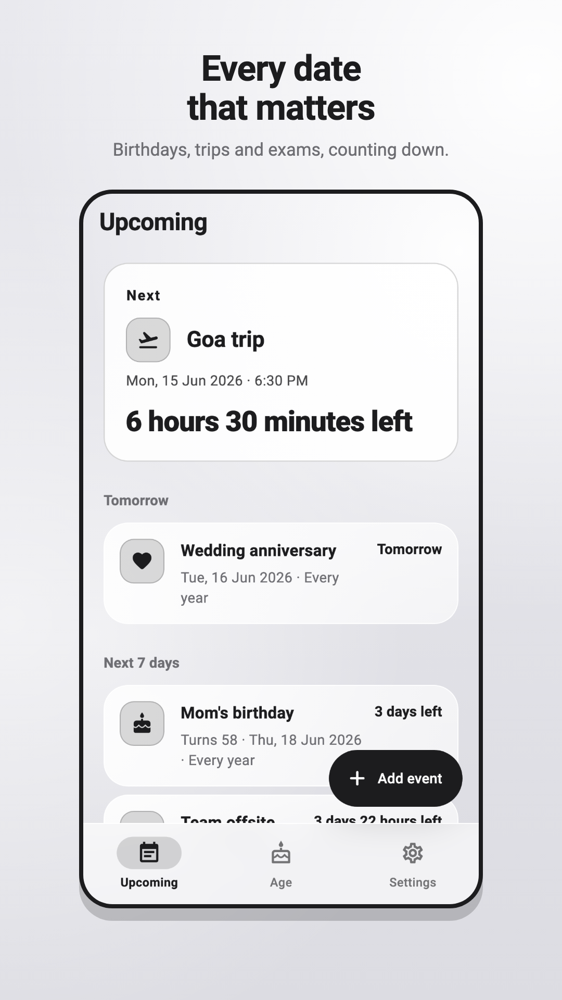
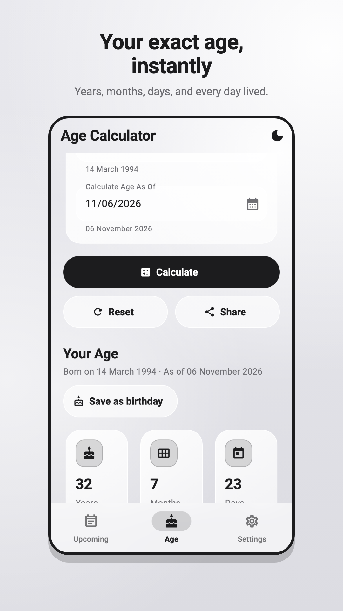
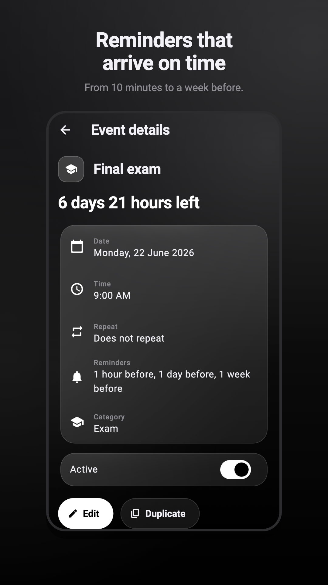
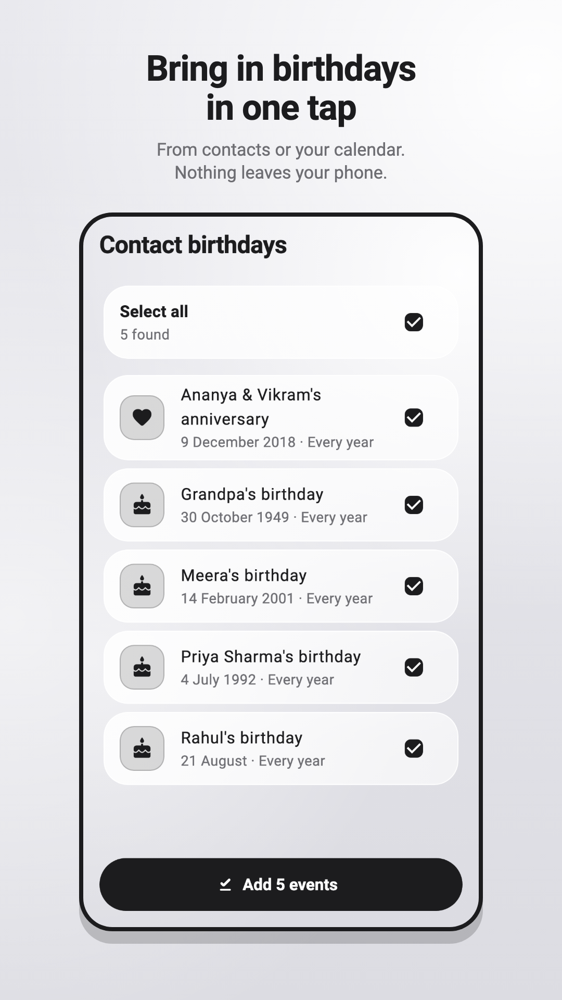

<p align="center">
  
</p>

<h1 align="center">Age Calculator</h1>

<p align="center">
  Exact ages, countdowns and reminders, in iOS-style glass.<br/>
  Private and offline: no account, no internet permission, no data collected.
</p>

<p align="center">
  <a href="https://play.google.com/store/apps/details?id=com.chandra.agecalculator"></a>
  <a href="https://github.com/ChandraChaan/age-calculator-flutter/actions/workflows/ci.yml"></a>
  
  
  <a href="LICENSE"></a>
</p>

<p align="center">
  
  
  
  
</p>

---

## Features

**Age**
- Exact age in years, months and days, as of today or any date
- Total time lived in days, weeks, months, hours and minutes
- Next birthday countdown and the weekday you were born
- Leap-day birthdays handled correctly (29 February → 28 February in other years)
- Life expectancy estimate
- Share your result

**Upcoming events**
- Birthdays, anniversaries, trips, exams, meetings and other dates
- Live countdowns to the minute, grouped into Today, Tomorrow, Next 7 days and Later
- Repeats: daily, weekly, monthly (month-end safe) and yearly
- "Turns 27" on birthdays, pause and resume, duplicate, undo delete
- Android home screen widget showing what's next

**Reminders**
- Each event chooses its own: at start, 10 or 30 minutes, 1 or 3 hours, 1 day or 1 week before
- All-day events remind at 9:00 AM
- Exact delivery when the user allows it (Settings → On-time reminders); otherwise inexact
- Rescheduled after reboots, time changes and every app launch

**Import (optional, read-only)**
- Birthdays and anniversaries from contacts, including ones saved without a year
- Events from your calendars for the next 6 months, keeping repeats the app supports
- An explanation is shown before Android's permission prompt; nothing is written back and nothing leaves the device

**Design**
- iOS-style frosted glass with no accent colour: ink on light grey, white on true black
- Light, dark or system theme
- Layouts tested on phones down to 320 dp wide, at text scales up to 200%

---

## Privacy

Everything happens on the device. The app has no backend, no analytics, no ads and no
internet permission. Events are stored in the app's private storage.

| Permission | Why | When it's asked |
|------------|-----|-----------------|
| `POST_NOTIFICATIONS` | Event reminders | The first time an event has a reminder |
| `SCHEDULE_EXACT_ALARM` | Reminders on the exact minute (optional) | Only from Settings → On-time reminders |
| `RECEIVE_BOOT_COMPLETED` | Restore reminders and the widget after a restart | Never (normal permission) |
| `READ_CONTACTS` | Import birthdays and anniversaries | Only when you choose to import |
| `READ_CALENDAR` | Import calendar events | Only when you choose to import |

Privacy policy: [docs/privacy-policy.html](docs/privacy-policy.html), published at
<https://chandrachaan.com/privacy-policy.html>.

---

## Getting started

Requirements: Flutter 3.44 (stable), Dart 3.12, Android SDK with API 24+ and Java 17.

```bash
git clone https://github.com/ChandraChaan/age-calculator-flutter.git
cd age-calculator-flutter
flutter pub get
flutter run
```

### Checks

```bash
dart format --output=none --set-exit-if-changed lib test
flutter analyze
flutter test
```

The engine tests include an exhaustive regression suite (several million date pairs) and
time-zone cases; `tool/run_tests_in_time_zones.sh` runs the suite under several zones.

### Release build

Release builds are shrunk with R8 and signed with the upload key from
`android/key.properties` (not committed):

```properties
storeFile=/absolute/path/to/upload-keystore.jks
storePassword=…
keyAlias=upload
keyPassword=…
```

```bash
flutter build appbundle --release   # build/app/outputs/bundle/release/app-release.aab
```

Without `key.properties` the bundle is built unsigned, which is what CI does.

---

## Continuous integration

[`.github/workflows/ci.yml`](.github/workflows/ci.yml) runs on every push to `main` and
every pull request:

1. **Analyze and test**: formatting, `flutter analyze`, and the full Flutter test suite with coverage
2. **Android release build**: Kotlin unit tests for the home screen widget, then an R8 release bundle (uploaded as a build artifact)

---

## Store assets

The Play Store icon, feature graphic, and phone and tablet screenshots in
[`store_assets/`](store_assets) are rendered from the real app widgets with sample events:

```bash
flutter test tool/store_assets/render_store_assets_test.dart
```

This also writes the legacy launcher icons in `android/app/src/main/res/mipmap-*`. The
adaptive icon itself is vector XML in `android/app/src/main/res/drawable/`.

| Asset | Size |
|-------|------|
| `icon-512.png` | 512 × 512 |
| `feature-graphic.png` | 1024 × 500 |
| `screenshots/*.png` (phone) | 1080 × 1920 |
| `tablet/*.png` (7- and 10-inch) | 1440 × 2560 |

---

## Project structure

```
lib/
├── main.dart, app.dart        App entry, theme mode, service wiring
├── engine/                    Pure Dart: dates, ages, recurrence, countdowns,
│                              upcoming plan, reminder plan, life expectancy
├── models/                    Event (with reminders and import source), AgeResult
├── data/                      Versioned JSON event store on SharedPreferences
├── state/                     EventController (serialised, undo-safe changes)
├── services/                  Reminders (notifications), contact/calendar import,
│                              sharing, age service
├── home_widget/               Snapshot + sync for the Android home screen widget
├── screens/                   Upcoming, Age, Settings, event detail/editor,
│                              import, life expectancy
├── widgets/                   Glass surfaces, cards, tiles, date fields
├── theme/                     Monochrome glass theme (AppPalette, AppTheme)
└── utils/                     Formatting and date input helpers

android/app/src/main/kotlin/com/chandra/agecalculator/
├── MainActivity.kt            Method channels and permission results
├── deviceimport/              Read-only contacts and calendar queries
└── widget/                    Home screen widget (RemoteViews, refresh scheduling)

test/                          Unit, widget and integration tests
tool/store_assets/             Store asset renderer
docs/                          Architecture notes, decisions, privacy policy
```

Design notes and history: [docs/CURRENT_STATE_AUDIT.md](docs/CURRENT_STATE_AUDIT.md),
[docs/FUTURE_PRODUCT_ARCHITECTURE.md](docs/FUTURE_PRODUCT_ARCHITECTURE.md),
[docs/V1_1_DECISIONS.md](docs/V1_1_DECISIONS.md).

---

## Tech stack

| Package | Purpose |
|---------|---------|
| Flutter / Material 3 | UI |
| `shared_preferences` | Event store and settings |
| `flutter_local_notifications`, `timezone` | Scheduled reminders |
| `intl` | Date formatting |
| `share_plus` | Sharing results |
| Kotlin (no plugin) | Home screen widget, contacts and calendar import |

---

## Releases

| Version | Highlights |
|---------|------------|
| 1.3.1 | iOS-style monochrome glass theme, new icon, new store listing |
| 1.3.0 | Reminders, contact and calendar import, glass redesign, R8, CI |
| 1.2.x | Android home screen widget, life expectancy estimate |
| 1.1.0 | Events, recurrence, upcoming countdowns |
| 1.0.1 | Correct age engine (DST, month-end and leap-day fixes) |

---

## License

[MIT](LICENSE) © 2026 Chandra ObulaReddy
